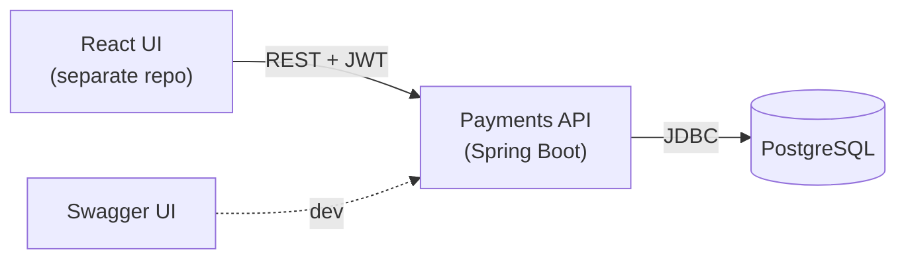
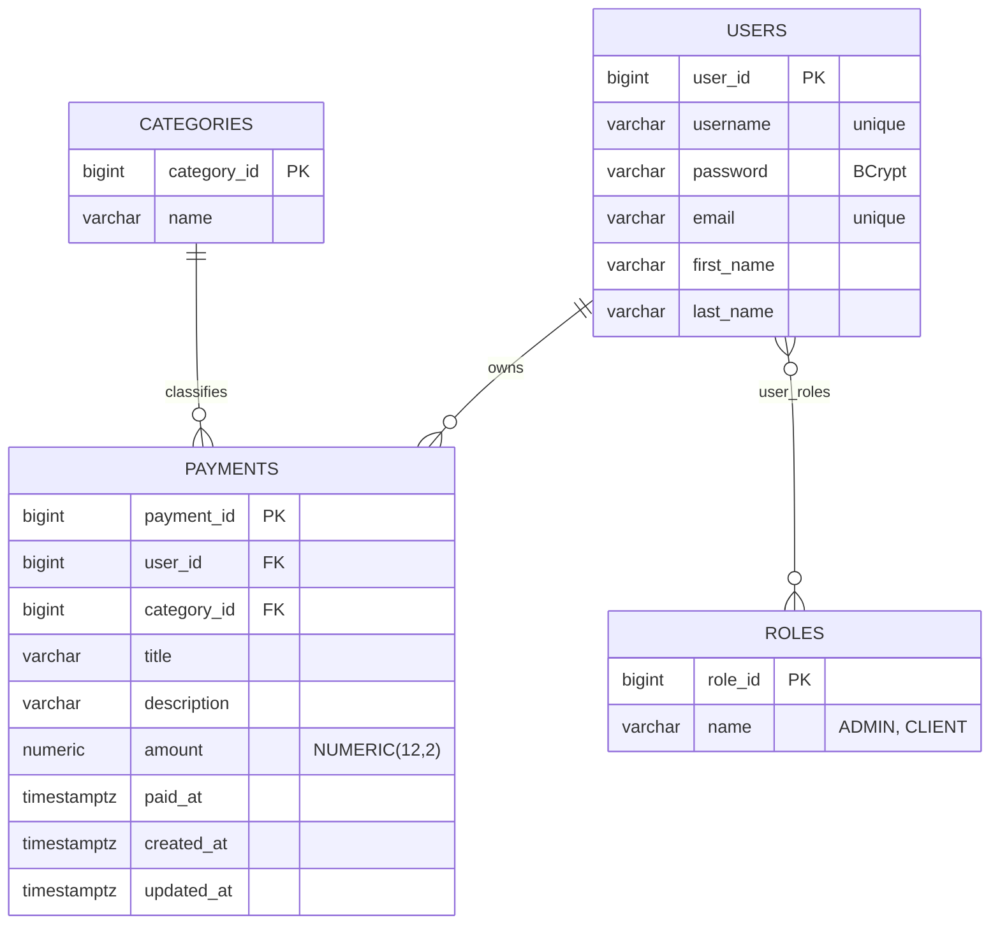
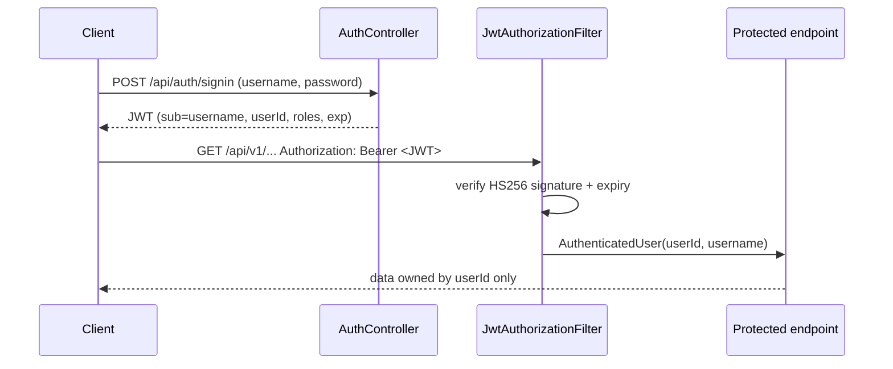

# Architecture

Technical overview of the Payments API (backend only). Keep this file in sync with the code: any change
to the structure, data model, security or infrastructure updates this document in the same branch.

## System context



- One Spring Boot application, stateless REST API.
- Self-hosted on a VPS (Docker); PostgreSQL is the only external dependency.
- The frontend lives in a separate repository and talks to the API over HTTP with a Bearer token.

## Stack

| Area | Choice |
|---|---|
| Language / runtime | Java 17 |
| Framework | Spring Boot 2.5.4 (Web, Data JPA, Security, Validation) |
| Build | Gradle 7.2 wrapper |
| Database | PostgreSQL; schema managed by Liquibase |
| Auth | Stateless JWT (HS256) via `com.auth0:java-jwt` |
| API docs | Swagger via springfox 2.9.2 (legacy) |
| Tests | JUnit 5 + Testcontainers (`postgres:16-alpine`), integration tests only |
| CI | GitHub Actions: `./gradlew build` on PRs and pushes to `master` |

## Code layout (`src/main/java/payments/duo/`)

```
controller/      REST endpoints: /api/auth/** (public), /api/v1/** (authenticated)
service/         service interfaces
service/impl/    business logic (payments, reports, users, auth)
repository/      Spring Data JPA repositories (JPQL for period queries and report sums)
model/           JPA entities: Payment, Category, auth/User, auth/Role
model/request/   incoming *Command / *Request objects (Bean Validation)
model/response/  outgoing *Response / *DTO objects
security/        SecurityConfig, JwtAuthorizationFilter, JwtTokenProvider, AuthenticatedUser
configs/         security beans (password encoder, CORS), Swagger
exception/       custom exceptions + CustomizedEntityExceptionHandler (@RestControllerAdvice)
utils/           Constants (messages), UserFactory (mapping), custom validators
```

Request flow: `Controller` → `Service` (interface) → `Repository` → PostgreSQL. Controllers never return JPA
entities to clients except `CategoryController` (see [Known gaps](#known-gaps)).

## Data model



- **Money** is `BigDecimal` / `NUMERIC(12,2)`; requests are validated with `@Positive` and
  `@Digits(integer = 10, fraction = 2)`.
- **Time**: `paid_at` is entered by the user (`Instant`); `created_at` / `updated_at` are set by Hibernate.
- **Periods**: monthly and yearly lists and reports use half-open ranges `[from, to)` computed in
  `app.timezone` (env `APP_TIMEZONE`, default `Europe/Kyiv`).
- **Categories** are global seed data (14 rows, changeset 002), shared by all users.
- **Roles** (ADMIN, CLIENT) are seeded; signup assigns CLIENT. No endpoint is role-specific today.
- **Migrations** live in `src/main/resources/db/changelog/changeSet/NNN-*.xml`; applied changesets are
  never edited, every schema change is a new file. `spring.jpa.hibernate.ddl-auto=none`.

## Security



- Signup: `POST /api/auth/signup`; password stored with BCrypt (strength 12).
- Signin: `POST /api/auth/signin` → JWT signed with `SECRET`, lifetime `EXPIRE_TIME` ms. Bad credentials → 401.
- Every `/api/v1/**` request passes `JwtAuthorizationFilter`, which builds the `AuthenticatedUser`
  principal from the `userId` claim. Invalid or missing token → JSON error response.
- **Ownership**: the current user always comes from `@AuthenticationPrincipal`, never from request data.
  Another user's payment or profile is treated as missing → 404 (its existence is not revealed).
- Sessions are stateless; CSRF disabled; CORS allows `http://localhost:3000` and `http://localhost:5173`.
- No refresh tokens and no token revocation yet.

## Error handling

`CustomizedEntityExceptionHandler` returns a JSON body with a list of messages:

| Case | Status |
|---|---|
| Bean Validation failure | 400 (one message per field) |
| Bad credentials | 401 |
| Payment / category / user not found (or not owned) | 404 |
| Any other exception | 400 (see Known gaps) |

## Configuration

Environment variables (template: `.env.example`):

| Variable | Required | Purpose |
|---|---|---|
| `DATABASE_URL` | yes | JDBC URL |
| `DB_USERNAME`, `DB_PASSWORD` | yes | DB credentials |
| `SECRET` | yes | JWT signing secret |
| `EXPIRE_TIME` | yes | JWT lifetime, ms |
| `APP_TIMEZONE` | no | zone for month/year boundaries (default `Europe/Kyiv`) |

`.env.example` also lists variables reserved for the planned auth rework (`APP_BASE_URL`,
`BOOTSTRAP_EMAIL`, `TELEGRAM_BOT_TOKEN`, `GOOGLE_CLIENT_ID`, `GOOGLE_CLIENT_SECRET`); the code does not read
them yet.

## Infrastructure

- **Local**: `docker-compose.yml` (compose project `payments`) runs `payments-postgres` (`postgres:16-alpine`,
  port 5432, volume `payments_postgres_data`) and `payments-api` (built from `Dockerfile`, port 8080).
  The API image copies the jar from `build/libs`, so `./gradlew build` runs first.
- **Tests**: `AbstractIntegrationTest` starts one shared Testcontainers Postgres; data tables are truncated
  after each test, seed data (categories, roles) is kept.
- **CI**: `.github/workflows/ci.yml` — Temurin 17, Gradle cache, `./gradlew build`; test reports uploaded on failure.

## Known gaps

- `GET /api/v1/category` returns the `Category` entity directly instead of a DTO.
- The catch-all exception handler answers 400 with the raw exception message; should be 500 + generic message.
- springfox is legacy (to be replaced by springdoc with the Spring Boot upgrade).
- Spring Boot 2.5 / `javax.*`; upgrade to a current Boot and Java LTS is planned.

## Planned changes

- **Auth rework**: onboarding through a Telegram bot, email verified via Google, invite-only sign-up,
  Google sign-in for the UI; passwords and `username` removed afterwards.
- Spring Boot / Java upgrade, springdoc.
